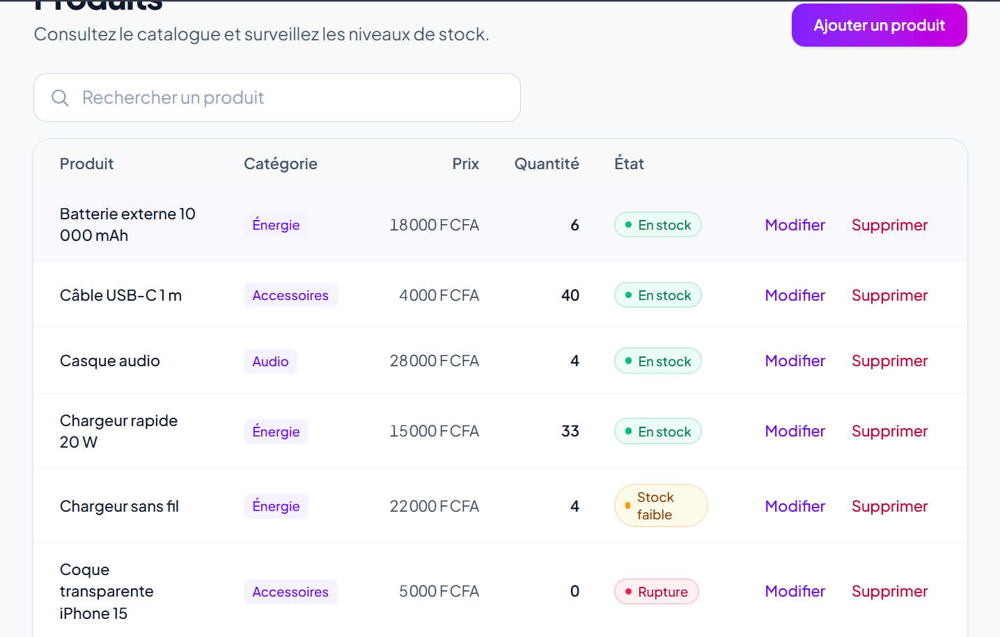
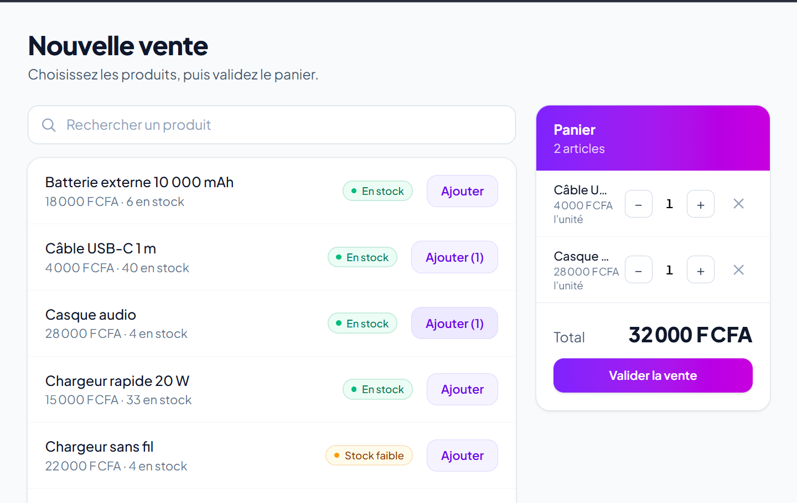
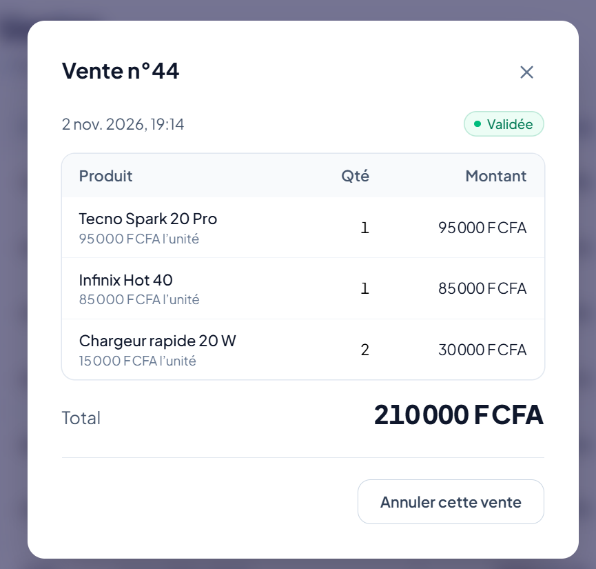
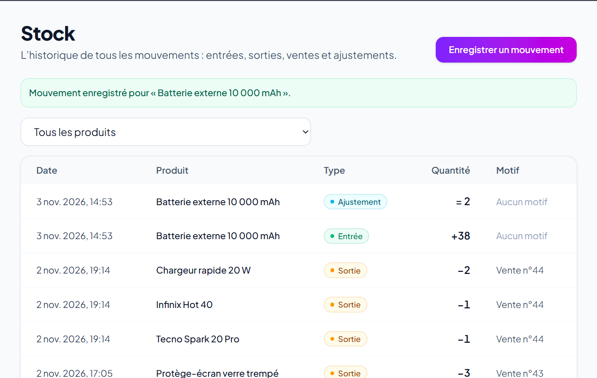
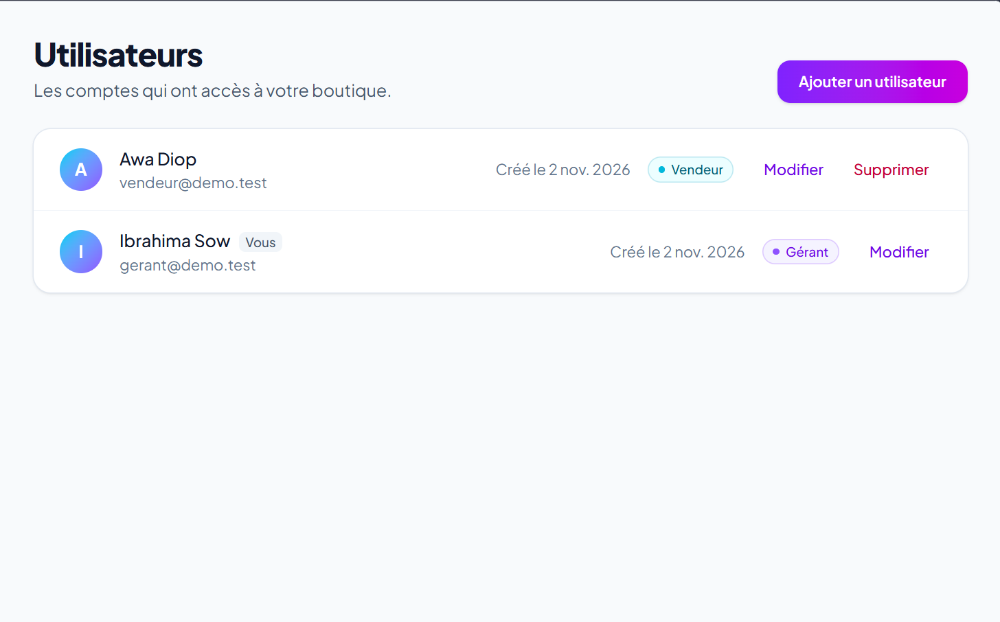
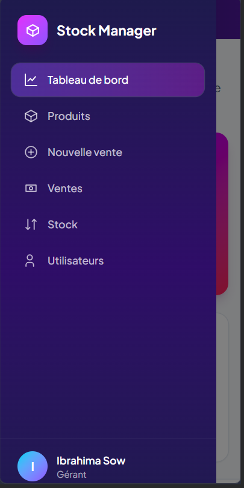

# Stock Manager

Application web de **gestion de stock et de ventes** pour les petits commerces : catalogue, mouvements de stock, caisse, annulation de vente, tableau de bord et gestion des employés. API REST en NestJS et MySQL, interface en React.

> **Démo en ligne :** *lien à ajouter après la mise en ligne*


## Aperçu

| Tableau de bord | Produits |
|---|---|
|  |  |

| Nouvelle vente | Détail d'une vente |
|---|---|
|  |  |

| Historique du stock | Utilisateurs |
|---|---|
|  |  |

L'interface s'adapte aux téléphones :



## Fonctionnalités

- **Catalogue** : produits avec catégories, recherche, pagination, alertes de stock faible et de rupture.
- **Stock** : historique complet des mouvements (entrées, sorties, ajustements d'inventaire). Le stock ne peut pas être modifié directement : il ne change que par un mouvement ou une vente, donc chaque variation est expliquée.
- **Ventes** : panier, validation, historique avec détail, **annulation** (le stock est remis et l'annulation est tracée).
- **Tableau de bord** (gérant) : chiffre d'affaires du jour et du mois, graphique des 7 derniers jours, produits les plus vendus, stock à surveiller. Les ventes annulées ne sont pas comptées.
- **Comptes** : le gérant crée, modifie, réinitialise le mot de passe et supprime les comptes de ses employés.

### Deux rôles

| | Gérant | Vendeur |
|---|---|---|
| Consulter produits, stock, ventes | oui | oui |
| Enregistrer une vente | oui | oui |
| Créer, modifier, supprimer un produit | oui | non |
| Enregistrer un mouvement de stock | oui | non |
| Annuler une vente | oui | non |
| Tableau de bord | oui | non |
| Gérer les comptes | oui | non |

## Stack technique

| | |
|---|---|
| **Backend** | NestJS 12, TypeScript, TypeORM, MySQL 8 |
| **Frontend** | React, TypeScript, Vite, Tailwind CSS, React Router, Axios |
| **Sécurité** | JWT, bcrypt, helmet, CORS, limitation de requêtes |
| **Tests** | Jest et Supertest (39 tests de bout en bout) |

## Points techniques notables

- **Cohérence du stock sous concurrence.** Une vente et son annulation s'exécutent dans une **transaction** avec des **verrous pessimistes** (`SELECT ... FOR UPDATE`). Si deux ventes visent le dernier exemplaire en même temps, une seule réussit. Les produits sont verrouillés dans l'ordre de leur identifiant pour éviter les interblocages. Un test lance cinq ventes simultanées pour le prouver.
- **Une vente échouée n'a aucun effet.** Si une ligne du panier manque de stock, tout est annulé (*rollback*), y compris les débits déjà faits sur les autres produits. C'est également couvert par un test.
- **Le prix vient du serveur.** Le client n'envoie que des identifiants et des quantités ; le prix est lu en base et copié dans la ligne de vente, donc changer un prix ne réécrit pas l'histoire.
- **Sécurité par défaut.** Les gardes d'authentification et de rôles sont globaux : une route est protégée sauf si elle est explicitement marquée publique.
- **Révocation immédiate.** Le compte est relu en base à chaque requête : supprimer un employé ou changer son rôle prend effet tout de suite, sans attendre l'expiration de son jeton.
- **Validation stricte.** Chaque entrée passe par un DTO ; les champs inconnus sont refusés. Les mots de passe sont hachés avec bcrypt et ne sont jamais renvoyés.
- **Migrations TypeORM** versionnées à la place de la synchronisation automatique du schéma.
- **Interface soignée.** États de chargement, vides et d'erreur sur chaque page, recherche retardée avec annulation des requêtes obsolètes, attributs d'accessibilité, mode réduit des animations.

## Lancer le projet en local

**Prérequis :** Node.js 24 ou plus récent (testé avec Node 26) et MySQL 8.

```bash
git clone https://github.com/itsmeprincepapa/stock-manager.git
cd stock-manager
```

### 1. Backend

Créer la base de données :

```sql
CREATE DATABASE stock_manager CHARACTER SET utf8mb4 COLLATE utf8mb4_unicode_ci;
```

Installer et configurer :

```bash
cd backend
npm install
cp .env.example .env      # sous Windows : copy .env.example .env
```

Renseigner dans `.env` le mot de passe MySQL et un `JWT_SECRET` long et aléatoire.

| Variable | Rôle |
|---|---|
| `DB_HOST`, `DB_PORT`, `DB_USERNAME`, `DB_PASSWORD`, `DB_NAME` | connexion à MySQL |
| `JWT_SECRET` | clé qui signe les jetons (à garder secrète) |
| `JWT_EXPIRES_IN` | durée de validité d'un jeton (par exemple `1d`) |
| `DB_MIGRATIONS_RUN` | `true` : les migrations s'appliquent au démarrage |
| `FRONTEND_URL` | adresse autorisée par CORS (facultatif, `http://localhost:5173` par défaut) |

Remplir la base avec des données de démonstration (comptes, produits, ventes) :

```bash
npm run seed
```

Ou, pour partir d'une base vide, créer le premier compte (il devient gérant) avec `POST /auth/register`.

Lancer le serveur :

```bash
npm run start:dev         # http://localhost:3000
```

### 2. Frontend

```bash
cd frontend
npm install
cp .env.example .env
npm run dev               # http://localhost:5173
```

### Comptes de démonstration

Disponibles après `npm run seed`. Ces identifiants sont publics et ne protègent que des données fictives.

| Rôle | Email | Mot de passe |
|---|---|---|
| Gérant | `gerant@demo.test` | `DemoGerant2026` |
| Vendeur | `vendeur@demo.test` | `DemoVendeur2026` |

Pour réinitialiser la démonstration : supprimer puis recréer la base, et relancer `npm run seed`.

## Tests

Les tests utilisent leur **propre base**, vidée à chaque exécution (un garde-fou refuse de tourner sur une base dont le nom ne finit pas par `_test`).

```sql
CREATE DATABASE stock_manager_test CHARACTER SET utf8mb4 COLLATE utf8mb4_unicode_ci;
```

```bash
cd backend
npm run test:e2e
```

Ils couvrent l'authentification, les rôles, la validation, la pagination, les ventes, l'annulation, la gestion des comptes, la concurrence et la limitation des connexions.

## Structure du dépôt

```
stock-manager/
├── backend/
│   ├── src/
│   │   ├── auth/             connexion, JWT, gardes, décorateurs
│   │   ├── users/            comptes et rôles
│   │   ├── categories/       catégories
│   │   ├── products/         produits
│   │   ├── stock-movements/  historique du stock
│   │   ├── sales/            ventes et annulations
│   │   ├── dashboard/        statistiques
│   │   ├── migrations/       évolutions du schéma
│   │   └── seed.ts           données de démonstration
│   └── test/                 tests de bout en bout
├── frontend/
│   └── src/
│       ├── api/              appels au serveur
│       ├── auth/             contexte de connexion, pages protégées
│       ├── components/       composants réutilisables
│       └── pages/            écrans de l'application
└── docs/screenshots/         captures d'écran
```

## Limites connues et pistes d'amélioration

Ce projet est un travail de portfolio ; voici ce que je ferais pour un usage réel.

- **Jeton dans `localStorage`** : simple, mais exposé aux attaques XSS. Un cookie `httpOnly` avec protection CSRF serait plus sûr.
- **Pas de jeton de rafraîchissement** ni de verrouillage d'un compte après plusieurs échecs de connexion.
- **Pas de journal d'audit** des actions du gérant.
- **Pagination par décalage** : suffisante pour une boutique, mais lente sur de très grosses tables (la pagination par curseur serait préférable).
- **Une seule boutique par installation** : pas de multi-boutiques.
- **Suppression de compte seulement** : pas de désactivation temporaire.
- **Migrations appliquées au démarrage** : avec plusieurs instances, il faudrait les exécuter comme une étape séparée du déploiement.

## Licence

MIT, voir le fichier `LICENSE`.

Réalisé par [PAPA MBACKE NDIAYE].